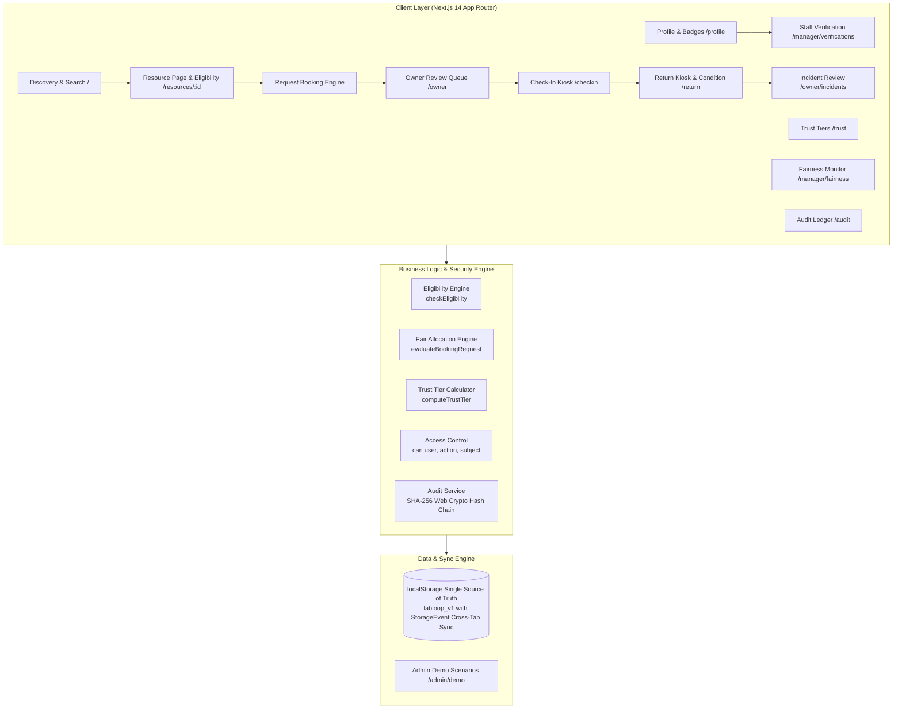

# LabLoop 🔬⚡

> **Unlocking Underused Equipment & Spaces** — A trusted platform for academic makerspaces, shared labs, and fabrication facilities. Featuring verified eligibility, explainable fair-share allocation, tamper-evident SHA-256 audit trails, and strict human-in-the-loop oversight.

Built for the 48-Hour Hackathon • Next.js 14 App Router • TypeScript • Tailwind CSS • Web Crypto API

---

## 🎯 Problem & Vision

Academic institutions invest millions in high-end machinery (laser cutters, CNC mills, electron microscopes, autoclaves, cleanrooms), yet these resources remain bottlenecked by:
1. **Underutilization & Siloed Ownership**: High-end gear sits idle while prospective users lack discovery or clear access pathways.
2. **Safety & Compliance Liability**: Equipment cannot be operated safely without verified training, credentials, or faculty supervision.
3. **Monopolisation & Hoarding**: Without fair allocation rules, well-funded teams or early bookers monopolize peak hours.
4. **Accountability Disputes**: When damage or late returns occur, paper logs provide zero tamper-evident proof of who was responsible or the baseline condition before use.

**LabLoop solves this completely** through an audited lifecycle: verified equipment listings → automated eligibility checks → explainable fair-share scoring → owner review with human confirmation → QR check-in & return with before/after condition reports → tamper-evident cryptographic audit ledger.

---

## 🚀 Quick Start

### Prerequisites
- Node.js 18+ (tested on Node.js v20/v22/v26)
- npm 9+

### Installation & Run
```bash
# 1. Clone or navigate to the repository
cd labloop

# 2. Install dependencies
npm install

# 3. Run automated tests (0 external dependencies, uses Node native test runner)
npm test

# 4. Start the development server
npm run dev
```

Visit [http://localhost:3000](http://localhost:3000) in your browser.

> **One-Click Demo Setup**: Visit [http://localhost:3000/admin/demo](http://localhost:3000/admin/demo) to load judge personas, simulate busy weeks, simulate overdue sessions, or advance demo time.

---

## 🧪 10-Step Judge Evaluation Journey (Completed by 1 Person)

LabLoop provides 6 pre-configured demo personas with instantaneous 1-click persona switching from the top navigation bar or the [`/login`](http://localhost:3000/login) page.

| Persona | Role | Credentials | Purpose |
| :--- | :--- | :--- | :--- |
| **Alex Chen** | Student | Undergrad, Safety Badged | Request bookings, test eligibility & fair waitlist |
| **Priya Patel** | Researcher | Grad Student, Cleanroom Certified | Submit certificates, experience auto-suggested alternatives |
| **Dr. Sarah Jenkins**| Owner | Lab Director, CNC & Lasers | Review queue, approve/waitlist/reject, fleet controls |
| **Dr. Marcus Vance** | Manager | Department Facilities Head | Verify credentials, fairness monitor, inspect hoarding |
| **Elena Rostova** | Admin | Chief Compliance & Safety Officer | Cryptographic audit ledger, chain tamper demonstration |
| **Jamie Taylor** | Student | Novice, Missing Safety Badges | Test hard eligibility gating & safety locks |

### Follow This Step-by-Step Flow:

1. **Step 1: Explore Discovery & Filters (`/`)**
   - As **Alex Chen**, search for "Laser" or "Microscope".
   - Toggle **"Show Only Eligible"** to see instant filtering based on Alex's training badges.
   - Click on the **Epilog Fusion Pro Laser Cutter**.

2. **Step 2: Interactive Eligibility & Priority Preview (`/resources/[id]`)**
   - Review specs, hourly operating rate, safety level, and live weekly availability calendar.
   - Expand **"Am I Eligible?"** to view the live badge breakdown (Alex has `laser-cutter-l1`).
   - Fill the booking form (Select Date, Time, Purpose: "Senior Capstone").
   - Notice the live **Priority Score Preview (76/100)** calculated transparently: Tier + Capstone purpose + No recent usage penalty.
   - Submit the booking request.

3. **Step 3: Missing Badge Gating & Document Upload (`/profile`)**
   - Switch persona to **Jamie Taylor** (Novice).
   - Visit the Electron Microscope (`/resources/res-sem-001`). Notice booking is hard-locked due to missing `cleanroom-cert` and `bio-safety-l2`.
   - Go to [`/profile`](http://localhost:3000/profile) and upload a training PDF or image (e.g. `bio-safety-cert.pdf`). Status is marked `pending_review`.

4. **Step 4: Facility Staff Verification Queue (`/manager/verifications`)**
   - Switch persona to **Dr. Marcus Vance** (Manager).
   - Open [`/manager/verifications`](http://localhost:3000/manager/verifications) to review Jamie's uploaded certificate.
   - Click **Approve & Grant Badge**. Jamie is instantly awarded the badge, written to the audit ledger.

5. **Step 5: Owner Review Queue & Conflict Handling (`/owner`)**
   - Switch persona to **Dr. Sarah Jenkins** (Owner).
   - Navigate to [`/owner`](http://localhost:3000/owner). Review pending booking requests.
   - For conflicting requests, view the AI/Rule-based priority recommendation and conflict slot suggestions.
   - Click **Approve**. LabLoop re-checks slot availability atomically before approval and requires written justification.

6. **Step 6: Printable Placard & Hardware QR Generation (`/resources/[id]/qr`)**
   - As Dr. Sarah, visit [`/resources/res-laser-001/qr`](http://localhost:3000/resources/res-laser-001/qr).
   - View the equipment placard with cryptographic signed HMAC verification token and `window.print()` support for physical mounting.

7. **Step 7: Check-In Kiosk & Baseline Condition Report (`/checkin`)**
   - Switch persona back to **Alex Chen** (Student).
   - Open [`/checkin`](http://localhost:3000/checkin).
   - Enter booking code or click **"Simulate Scan"**.
   - Complete safety checklist, enter Supervisor PIN (`1234` for high-risk equipment), take/upload a baseline condition photo, and click **Confirm Check-in**.

8. **Step 8: Return Kiosk, Before/After Comparison & Incident Filing (`/return`)**
   - Open [`/return`](http://localhost:3000/return).
   - See side-by-side **Before (Baseline) vs. After (Current)** photo inspection.
   - Select **"Report Abnormality / Minor Damage"**.
   - Fill out the damage brief and submit return. The system flags the session for human review and routes to the incident desk.

9. **Step 9: Neutral Incident Review & Human Confirmation (`/owner/incidents`)**
   - Switch persona to **Dr. Sarah Jenkins** (Owner).
   - Open [`/owner/incidents`](http://localhost:3000/owner/incidents).
   - Read the neutral incident summary (structured with timeline, damage report, and impact assessment).
   - Human owner selects resolution (e.g. *Written Warning*, *Equipment Suspension*, or *No Fault*). An appeal window is automatically provided.

10. **Step 10: Cryptographic Chain Verification & Tamper Demo (`/audit`)**
    - Switch persona to **Elena Rostova** (Admin).
    - Open [`/audit`](http://localhost:3000/audit).
    - Click **"Verify Cryptographic Integrity"** — the Web Crypto SHA-256 engine checks every block hash against `previous_hash` and payload content. Status: `CHAIN VALID (100% Intact)`.
    - Click **"Simulate Tamper on Block"** to alter a past record. Re-verify: the ledger flags the exact block index where the hash chain breaks!
    - Click **"Repair Chain"** to recalculate hashes or restore from seed.

---

## 🏛️ System Architecture



---

## ⚖️ Fair Allocation Engine & Scoring Formula

To eliminate favoritism and prevent monopolisation by aggressive bookers, LabLoop scores booking requests using a deterministic, explainable algorithm:

$$\text{Priority Score} = w_{\text{tier}} \cdot \text{TrustTier} + w_{\text{purpose}} \cdot \text{PurposeWeight} + w_{\text{fairness}} \cdot (100 - \text{RecentHoursHeld}) + w_{\text{deadline}} \cdot \text{Urgency}$$

### Key Fair Allocation Rules:
1. **Explainable Waitlist**: When a time slot has multiple requests, students can click **"Why this position?"** to inspect their score breakdown.
2. **Weekly Quota Capping**: Individual users cannot reserve more than 12 hours/week on high-demand equipment, and research groups cannot hoard more than 25 combined hours.
3. **No Automatic Approvals**: The engine computes priority scores, suggests alternative non-conflicting slots, and flags hoarding, but **final access decisions always require human owner confirmation**.
4. **Advisory Fairness Radar (`/manager/fairness`)**: Facility managers inspect Gini coefficients of equipment utilization, detect users hoarding cancellations, and dispatch non-punitive re-balancing nudges.

---

## 🔒 Security, Trust & Accountability

- **SHA-256 Cryptographic Hash Chain**: Every state transition (booking created, approved, checked in, badge granted, condition reported, incident resolved) is written into an append-only ledger. Each block contains:
  ```typescript
  hash = SHA-256(index + timestamp + action + actor_id + resource_id + JSON.stringify(payload) + previous_hash)
  ```
  Verified in the browser via standard `window.crypto.subtle.digest`.
- **Pre-Approval Privacy & FERPA Compliance**: Before an owner approves a booking, sensitive student identity (GPA, academic standing, full matriculation record) is anonymized. Owners only review required badges, project purpose, and priority score. Full identity is only revealed upon mutual check-in.
- **Physical QR Placard + Supervisor PIN**: High-risk machinery (CNC mills, Class 4 lasers) requires a physical on-site QR placard scan plus supervisor PIN authorization (`1234`) before powering on.

---

## 🤖 AI Disclosure & Human-in-the-Loop Safeguards

- **Scope of AI**:
  - Semantic equipment discovery & natural language matching (`/api/ai/match`).
  - Neutral 3-line incident briefs summarizing operator statements vs. baseline condition (`/api/ai/summarize-incident`).
- **Human Oversight Guarantee**:
  - AI models **NEVER** autonomously approve/reject bookings, apply sanctions, or assess penalties.
  - Every AI recommendation is explicitly labeled as `AI Suggestion` with an inspectable rationale and a required human confirmation button.
- **Deterministic Offline Fallback**:
  - All AI endpoints run on Anthropic Claude 3.5 Sonnet if `ANTHROPIC_API_KEY` is present.
  - If no API key is provided or the network is offline, deterministic heuristic engines provide instant, zero-failure fallbacks so the app operates with 100% reliability during offline judging.

---

## 🛠️ Tech Stack & Disclosures

| Technology | Purpose | Justification |
| :--- | :--- | :--- |
| **Next.js 14** (App Router) | Full-stack web framework | Server Components, dynamic API routes, performant client rendering |
| **TypeScript** | Type safety & domain modeling | Unified types in `src/lib/types.ts` shared across components, DB, and audit log |
| **Tailwind CSS** | Styling & UI design | Rapid design system implementation with clean visual hierarchy |
| **Lucide React** | Icons | Standard, lightweight icon set for accessible UI |
| **Recharts** | Analytics & fairness visualizations | Interactive bar charts, trend lines, and pie charts in `/admin/insights` |
| **Web Crypto API** | Cryptographic hash chaining | Browser-native, zero-dependency SHA-256 hashing conforming to W3C standards |
| **Node.js Test Runner** | Unit and E2E journey tests | Native `node --test` runner in `tests/run-tests.mjs` — executes in ~10ms with zero extra npm packages |

---

## 📁 Repository Structure

```
labloop/
├── docs/
│   ├── DEMO_SCRIPT.md          # 2-minute quick start + 3-minute pitch script
│   └── PROJECT_DOCUMENT.md     # 13-section comprehensive specification
├── src/
│   ├── app/
│   │   ├── admin/
│   │   │   ├── demo/page.tsx   # 1-Click judge test scenarios
│   │   │   └── insights/       # Recharts utilization & fairness graphs
│   │   ├── audit/page.tsx      # SHA-256 ledger viewer & tamper demo
│   │   ├── bookings/[id]/      # Complete booking timeline & audit trail
│   │   ├── checkin/page.tsx    # QR scanner, checklist & condition capture
│   │   ├── login/page.tsx      # 1-Click persona switcher
│   │   ├── manager/
│   │   │   ├── fairness/       # Hoarding detection & fairness radar
│   │   │   └── verifications/  # Credential & badge approval queue
│   │   ├── my-bookings/        # Student booking dashboard & waitlist breakdown
│   │   ├── notifications/      # Notification inbox & campus email simulator
│   │   ├── owner/
│   │   │   ├── incidents/      # Damage reporting & human resolution
│   │   │   ├── resources/new/  # Equipment listing wizard
│   │   │   └── page.tsx        # Review queue & fleet control
│   │   ├── privacy/page.tsx    # FERPA compliance & privacy model
│   │   ├── profile/page.tsx    # Certificate uploads & earned badges
│   │   ├── resources/[id]/     # Resource details, calendar & eligibility preview
│   │   │   └── qr/page.tsx     # Printable physical equipment placard
│   │   ├── return/page.tsx     # Before/after condition inspection
│   │   ├── trust/page.tsx      # Trust tier breakdown & roadmap
│   │   ├── layout.tsx          # App root with AppProvider & Navbar
│   │   └── page.tsx            # Discovery catalog & search
│   ├── components/
│   │   ├── Navbar.tsx          # Top navigation with role badge & switcher
│   │   └── RequireRole.tsx     # Role-based route guard
│   ├── lib/
│   │   ├── audit.ts            # SHA-256 hash chaining engine
│   │   ├── booking-engine.ts   # Double-booking, quota & priority scoring
│   │   ├── context.tsx         # Global AppProvider state & audited mutations
│   │   ├── db.ts               # LocalStorage single source of truth & listeners
│   │   ├── eligibility.ts      # Multi-factor badge & sanction checks
│   │   ├── overdue.ts          # Automated overdue session monitor
│   │   ├── permissions.ts      # Role-based access control matrix
│   │   ├── qr.ts               # QR signature generator & parser
│   │   ├── seed.ts             # 6 complete personas, resources & audit logs
│   │   ├── trust.ts            # Trust tier calculations & tier roadmap
│   │   └── types.ts            # Unified domain models
│   └── tests/
│       └── run-tests.mjs       # Native Node.js test suite
├── schema.sql                  # PostgreSQL production schema definition
├── tailwind.config.ts          # Tailwind theme configuration
└── package.json
```

---

## 🔍 Verification & Test Commands

To verify the build and test suite independently:

```bash
# Run unit & end-to-end journey tests (7/7 tests passing)
npm test

# Build for production (all 22+ routes static/dynamic)
npm run build
```

---

## ⚠️ Known Limitations & Future Roadmap

- **Storage**: Currently operates on `localStorage` for zero-setup judging. A production deployment will mount `schema.sql` against Supabase / Google Cloud PostgreSQL.
- **Physical Hardware Interlocks**: Check-in currently generates digitally signed placarding and software PIN verification; future hardware integration includes Shelly/Sonoff smart relays on power plugs triggered by API upon valid check-in.
- **Institutional Single Sign-On (SSO)**: Ready for SAML 2.0 / Shibboleth integration using existing user identity types.

---

## 📄 License & Attribution

Built for the Hackathon by the LabLoop Team. Licensed under the MIT License.
