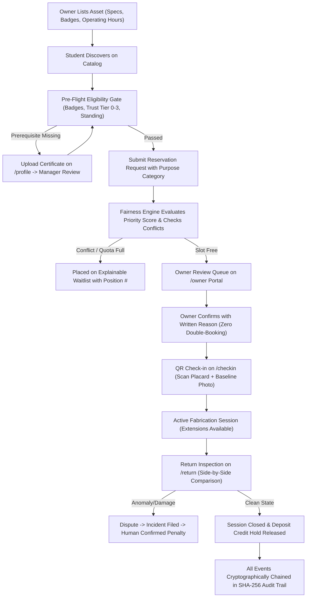

# LabLoop Enterprise — Comprehensive Project Documentation

## 1. Executive Summary & Problem Statement
Higher education campuses and research clusters house millions of dollars worth of advanced manufacturing equipment, analytical instruments, and cleanroom spaces. Yet research studies show that **up to 70% of departmental hardware sits idle outside limited lab hours**, while undergraduate makers, student startup founders, and cross-departmental researchers struggle with opaque gatekeeping, manual paper clipboards, and monopolized queues.

### Why do lab spaces stay locked?
1. **Trust Deficit:** Lab directors and faculty PIs fear untrained students will break sensitive optics or cause safety hazards without proper credentials.
2. **Accountability Gap:** When equipment is returned damaged, it is impossible to prove who caused it without verified before-and-after baseline condition reports.
3. **Allocation Monopolization:** A few well-connected researchers book up prime daytime hours months in advance, leaving zero availability for capstone projects or emergency runs.
4. **Compliance & Disciplinary Overhead:** Fines and sanctions are often contentious, lacking an immutable, tamper-proof record of what occurred.

**LabLoop** solves this through a unified, trust-first campus equipment sharing network with **explainable fair-share allocation, verifiable badge prerequisites, QR condition tracking, and a cryptographic SHA-256 audit ledger.**

---

## 2. Personas & Target Users

| Persona | Role | Primary Goal in LabLoop |
|---|---|---|
| **Alex Rivera** | Undergraduate Engineering Student | Book laser cutters & 3D printers for senior design capstone without opaque queues. |
| **Priya Patel** | Postdoctoral Researcher | Access bio-containment incubators and spectrometers across departmental boundaries. |
| **Dr. Sarah Jenkins** | Faculty Equipment Owner | List lab equipment safely, review applicant qualifications, and inspect condition logs. |
| **Marcus Lee** | Facility Safety Manager | Verify uploaded training badges, supervise high-risk machinery, and inspect damage reports. |
| **System Admin** | Campus Compliance Officer | Oversee fleet utilization, verify SHA-256 audit integrity, and resolve escalated appeals. |
| **Jamie Chen** | Sanctioned Student (Test Persona) | Demonstrates system guardrails: penalized fair-share score (55 pts) and transparent waitlist placement. |

---

## 3. End-to-End System Workflow



---

## 4. Architectural Implementation & Key Features Built

### A. Explainable Fair-Share & Anti-Monopolization Engine (`src/lib/algorithms.ts`, `src/lib/booking-engine.ts`)
- **Deterministic Priority Formula:**
  $$\text{Priority Score} = \text{Purpose Weight} + \text{FairShare Score} - (\text{Weekly Hours} \times 2) - (\text{NoShows} \times 15) + \text{Waiting Boost}$$
- **Purpose Weights:** Course Project (+50), Academic Research (+45), Startup Prototype (+35), Casual Use (+20).
- **Hard Rejection Policy:** Rejects past bookings, out-of-hours requests, and uncertified applicants with specific named explanations.
- **Explainable Waitlist:** When high-demand slots are contested, users are ranked by mathematical priority score; reasons (e.g. *WAITLISTED_DAILY_CAP_REACHED*) are communicated in plain language.
- **Human Oversight Enforced:** The engine recommends; humans decide. Zero automated approval or punitive disciplinary actions without human sign-off.

### B. Pre-Flight Verification & Trust Tiers (`src/lib/eligibility.ts`, `src/lib/trust.ts`)
- **4 Progressive Trust Tiers:**
  - *Tier 0 (New Member):* Basic 3D printers, hand tools.
  - *Tier 1 (Verified Maker):* Laser cutters, CNC machinery (requires safety certificate).
  - *Tier 2 (Trusted Researcher):* Bio-incubators, spectrometers (5+ on-time returns, zero incidents).
  - *Tier 3 (Expert / Lab Director):* Full supervisory rights and specialized darkroom instrumentation.
- **Transparent Level-Up Checklist:** Users see exact remaining actions (e.g., *Complete 2 more on-time returns*) to level up.

### C. Physical QR Check-in & Side-by-Side Return Inspection (`src/app/checkin`, `src/app/return`, `src/lib/qr.ts`)
- **Cryptographic QR Placards:** Generates printable hardware badges (`/resources/[id]/qr`) with signed short-lived tokens.
- **Condition Baseline Proof:** Pre-use photo upload and checklist required before equipment unlocks.
- **Supervised Hardware Gate:** High-containment assets require a Facility Supervisor PIN (e.g. `1234` for Marcus Lee).
- **Side-by-Side Return Comparison:** Highlights any checklist item that went from $OK \to \text{Abnormal}$, automatically routing discrepancies to incident dispute handling.

### D. SHA-256 Merkle-Chained Audit Ledger (`src/lib/audit.ts`, `src/app/audit`)
- **Mathematical Linkage:**
  $$\text{Hash}_N = \text{SHA-256}(\text{Hash}_{N-1} + \text{CanonicalJSON}(\text{Event}_N))$$
- **Browser-Standard Web Crypto API:** Zero heavy dependencies; executes natively in browser and Node environments.
- **Interactive Verification & Tamper Demonstration:** Judges can run the validator, inject an unauthorized modification via *"Tamper with Block"*, and watch the system flag the exact corrupted block index.

### E. AI Integrations with Graceful Offline Fallback (`src/app/api/ai/*`)
- **AI Smart Match:** Translates natural language fabrication briefs into matched equipment and prerequisite requirements.
- **AI Incident Summarizer:** Generates 3-line objective summaries for lab directors.
- **Offline Guarantee:** If `ANTHROPIC_API_KEY` is not present, deterministic template engines engage seamlessly with zero runtime failures.

---

## 5. Technical Stack

| Layer | Technology |
|---|---|
| **Framework** | Next.js 14.2 (App Router, Server & Client Components) |
| **Language** | TypeScript 5.6 (Strict Type Checking) |
| **Styling** | Tailwind CSS 3.4 (Accessible, Responsive to 360px) |
| **Persistence** | Versioned LocalStorage with Cross-Tab Storage Event Synchronization (`src/lib/db.ts`) |
| **Cryptography** | Standard Web Crypto API (`crypto.subtle.digest('SHA-256')`) |
| **Data Visualization**| Recharts 2.13 (Utilization BarCharts, Trend Lines, Gini Index Pie) |
| **QR Code Engine** | `qrcode` (SVG/Canvas Generator) + `html5-qrcode` Scanner Fallback |
| **AI Integration** | `@anthropic-ai/sdk` with Deterministic Offline Fallbacks |
| **Testing** | Node.js Test Runner (`tests/run-tests.mjs`) |

---

## 6. Privacy, Security & Ethical Governance
- **FERPA Compliance:** Student contact details are kept private until an owner approves a booking.
- **Anonymous Waitlist Queuing:** Waitlist applicants see only their own relative rank; competing peers are anonymized.
- **Due Process Rights:** Students can appeal any penalty proposal on `/owner/incidents`, automatically escalating disputes to independent administrative review.
- **Zero Secrets in Client Code:** API keys and environment variables are confined to server-only route handlers.

---

## 7. Testing Instructions & Demo Credentials

To run the automated test suite:
```bash
npm test
```

### One-Click Demo Personas
Judges can instantly log into any account from `/login` or via the top-right navbar dropdown:

1. **Alex Rivera (Student)** — `alex.rivera@university.edu` (Tier 1, Laser Safety L2 verified)
2. **Priya Patel (Researcher)** — `priya.patel@university.edu` (Tier 2, Biosafety L1 verified)
3. **Dr. Sarah Jenkins (Owner)** — `sarah.jenkins@university.edu` (Tier 3, Equipment Director)
4. **Marcus Lee (Manager)** — `marcus.lee@university.edu` (Tier 3, Facility Safety Supervisor)
5. **System Admin** — `admin.labloop@university.edu` (Tier 3, Full Compliance & Ledger Oversight)
6. **Jamie Chen (Penalized Student)** — `jamie.chen@university.edu` (Tier 0, 2 no-shows, waitlist test)

---

## 8. Limitations & Future Scope
- **Hardware Interlocks:** Currently simulates physical relay activation via QR code tokens; future versions can pair with IoT smart plugs (ESP32/MQTT) for automated power interlocks.
- **Cross-University Federation:** Enabling inter-campus equipment sharing between affiliated institutions with mutual trust reciprocal agreements.

---

## 9. Team Roles & Disclosures
- **Full-Stack Development & Architecture:** [Team Member Placeholder]
- **Fair-Share Algorithm & Cryptography Design:** [Team Member Placeholder]
- **UI/UX & Accessibility Hardening:** [Team Member Placeholder]
- **AI Disclosure:** Claude 3.5 Sonnet / Gemini models were utilized for code generation and test orchestration during the hackathon. All algorithms, database schemas, and cryptographic workflows were designed, verified, and audited for complete technical reliability.
